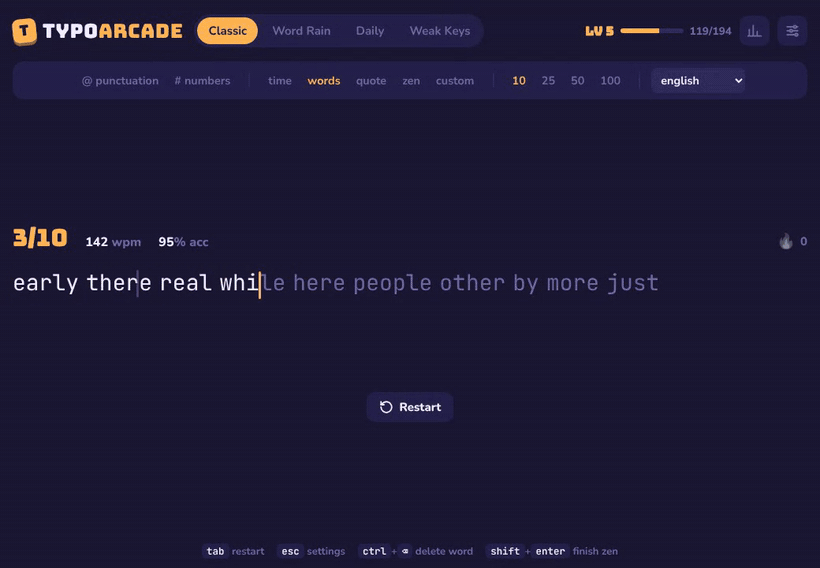
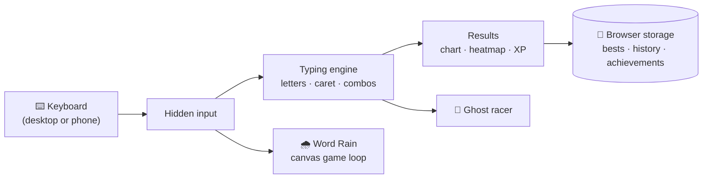

<div align="center">




<p>
  <a href="https://hemashreevi.github.io/typo-arcade/"></a>
  
  
  
</p>
<p>
  
  
  
  
  
</p>



<sub>A 10-word test: the ghost racer caret, live wpm, a fixed typo, then results with confetti and achievements.</sub>

</div>

---

## 🕹️ What is Typo Arcade?

A typing test that plays like an arcade game. Warm up with a classic speed test, then try **Word Rain**, take on the **Daily** challenge, or let **Weak Keys** drill the letters you keep missing. Every test earns XP, and new personal bests set off confetti.

## 🎮 Modes

<table>
<tr>
<td width="50%" valign="top">

### ⌨️ Classic
Time (**15 / 30 / 60 / 120 s**), word count (**10 / 25 / 50 / 100**), **quote**, **zen** or **your own text**. Turn punctuation and numbers on or off, and pick everyday English, tricky words or code.

</td>
<td width="50%" valign="top">

### 🌧️ Word Rain
Words fall from the sky. Type one and press space to blast it before it lands. Combos multiply your score, the rain speeds up every 8 words, and you have three lives.

</td>
</tr>
<tr>
<td valign="top">

### 📅 Daily
The same 30 words for everyone, every day. Come back tomorrow to keep your streak alive.

</td>
<td valign="top">

### 🎯 Weak Keys
Remembers which letters you miss and builds practice words from your weakest keys.

</td>
</tr>
</table>

## ✨ Features

| | |
| --- | --- |
| 👻 **Ghost racer** | A second caret runs at your personal best or a speed you choose. Try to stay ahead. |
| 🔥 **Combo flame** | Counts correct words in a row and lights up from 10. |
| 🏆 **XP, levels and 12 achievements** | Every test counts, and new bests set off confetti. |
| 📊 **Detailed results** | wpm, accuracy, raw speed, consistency, a speed chart with errors marked, and a heatmap of missed keys. |
| 🧠 **Practise your misses** | Turn the words you got wrong into a new test in one click. |
| 🥋 **Challenge settings** | Expert (a wrong word fails the run), master (a wrong key fails the run), stop on error, no backspace, blind mode. |
| 🎨 **Make it yours** | 8 themes, 6 fonts, text size, 4 caret styles, smooth caret, and focus mode that hides the menus while you type. |
| 🔊 **Sounds** | Click, pop, typewriter or **melody**, where every key plays a note. All synthesised, so there are no audio files. |
| 📱 **Works on phones** | Use your phone's own keyboard. |

## ⌨️ Shortcuts

| Key | Action |
| :---: | --- |
| <kbd>Tab</kbd> | Restart |
| <kbd>Esc</kbd> | Settings |
| <kbd>Ctrl</kbd> + <kbd>Backspace</kbd> | Delete the whole word |
| <kbd>Shift</kbd> + <kbd>Enter</kbd> | Finish a zen session |
| <kbd>Enter</kbd> | Next test (on the results screen) |

## 🚀 Run it

It's one HTML file: no install, no build, no dependencies.

```bash
git clone https://github.com/HemashreeVI/typo-arcade.git
cd typo-arcade
python -m http.server 8000   # open http://localhost:8000
```

You can also just double-click `index.html`.

<details>
<summary><b>🌐 Put it on GitHub Pages</b></summary>

<br>

**Settings → Pages → Deploy from a branch → `main` / `(root)` → Save.**
A minute later it's live at `https://hemashreevi.github.io/typo-arcade/`.

</details>

<details>
<summary><b>🛠️ How it's built</b></summary>

<br>



- **Typing engine:** a hidden input catches every key, which is what makes phone keyboards work. Each letter is its own element, and the caret moves by measuring where the next letter sits.
- **Word Rain:** a canvas game loop with exploding-letter particles.
- **Sounds:** generated live with the Web Audio API.
- **Your progress:** stored in your own browser only. Nothing is sent anywhere.

</details>


<div align="center">

**Built by [Hemashree V I](https://hemashreevi.github.io)** ⌨️✨

<a href="https://hemashreevi.github.io"></a>
<a href="https://www.linkedin.com/in/hema-shree-373622289"></a>

<sub>If you enjoyed it, a ⭐ helps others find it.</sub>

</div>
